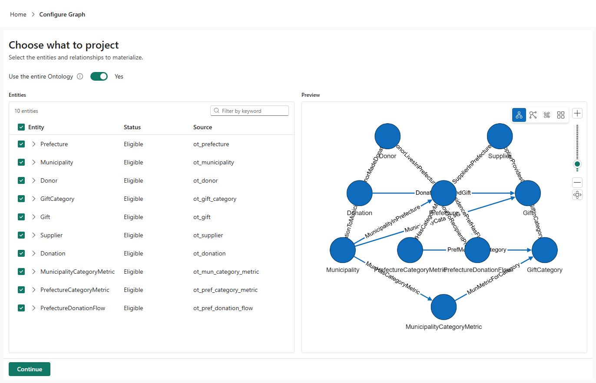

# 16.2 操作手順（1）

[Lab 目次](../README.md) · [この章の目次](README.md)

1. 問いを決め、必要な最小の範囲（Gift、Supplier、SupplierProvidesGift）を書き出します。講師の指示で全体を使う場合は、10 Entity・15 Relationship を選びます。
2. Home の Manage graph から Configure Graph を開き、各項目の Status を確認します。Ineligible の項目は、ツールチップで理由を読みます。講師の指示で全体を使う場合を除き、Use the entire Ontology を Yes のままにせず、手順1で決めた範囲の Eligible な項目だけを選びます（Entity を展開すると、その Relationship を選べます）。選んだ範囲が Eligible で、Continue が有効な場合だけ次へ進みます。Unsupported Datasource などで対象外の場合は理由を記録し、新規の実体化を止めます。未実体化の場合は GQL の確認も未実施として記録します。静的テーブルの検証結果とは分けて扱います。

Configure Graph の Choose what to project。各 Entity の Status と Source を確認する（図は全体を選んだ状態。演習では必要な範囲だけを選ぶ）

English

## 16.2 Steps

1. Fix the question and write down the smallest scope it needs (Gift, Supplier and SupplierProvidesGift). If the instructor tells you to use the whole model, select all 10 entities and 15 relationships.
2. Open Configure Graph from Manage graph on Home and check each item's Status. For Ineligible items, read the reason in the tooltip. Unless the instructor tells you to use the whole model, do not leave Use the entire Ontology at Yes; select only the Eligible items in the scope from step 1 (expand an entity to select its relationships). Continue only when the selected scope is Eligible and the button is enabled. If Unsupported Datasource or another reason makes it ineligible, record the reason and stop new materialization. If the graph is not materialized, record GQL checks as unrun. Treat this separately from static-table verification.

Choose what to project in Configure Graph: check each entity's Status and Source. The figure shows the whole model selected; in this lab, select only what you need.

