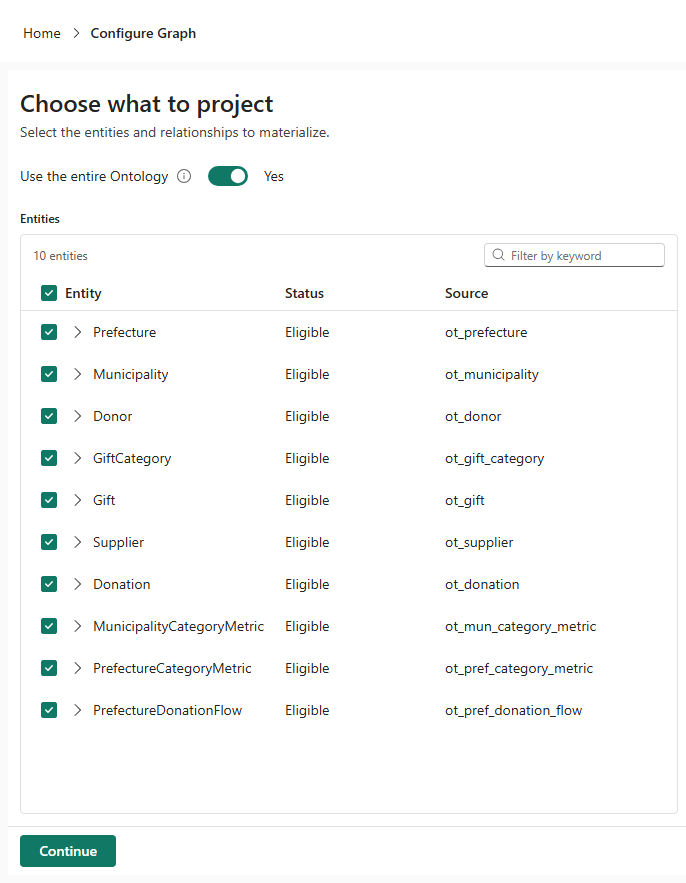

# 16.2 操作手順（1）

[Lab 目次](../README.md) · [この章の目次](README.md)

1. 問いを決め、必要な最小の範囲（Gift、Supplier、SupplierProvidesGift）を書き出します。講師の指示で全体を使う場合は、10 Entity・15 Relationship を選びます。
2. Home の Manage graph から Configure Graph を開き、各項目の Status を確認します。Ineligible の項目は、ツールチップで理由を読みます。講師の指示で全体を使う場合を除き、Use the entire Ontology を Yes のままにせず、手順1で決めた範囲の Eligible な項目だけを選びます（Entity を展開すると、その Relationship を選べます）。Semantic model binding や複数の backing table が理由なら、その組合せは Graph projection の対象外です。汎用的な binding 表示から source の種類を推定したり、根拠のない修復・再 binding をしません。必要な Entity/Relationship が Ineligible の場合は理由を記録し、その範囲の新規実体化を止めます。Continue は選んだ必須範囲がすべて Eligible で有効な場合だけ進みます。未実体化なら GQL は未実施として記録し、独立して実施可能な SQL・KQL・DAX の確認と区別します。図は選択画面の案内で、現在の適格性を証明しません。自分の必須範囲の Status を実行時に確認します。

「Choose what to project」の選択画面。Use the entire Ontology の切り替え、Entity のチェック欄、Status・Source で範囲を確認します。操作例であり、現在の適格性の証拠ではありません。

English

## 16.2 Steps

1. Fix the question and write down the smallest scope it needs (Gift, Supplier and SupplierProvidesGift). If the instructor tells you to use the whole model, select all 10 entities and 15 relationships.
2. Open Configure Graph from Manage graph on Home and check each item's Status. For Ineligible items, read the reason in the tooltip. Unless the instructor tells you to use the whole model, do not leave Use the entire Ontology at Yes; select only Eligible items in the scope from step 1 (expand an entity to select its relationships). If semantic-model binding or multiple backing tables is the reason, that combination is unsupported for Graph projection. Do not infer the source category from a generic binding display or attempt an unsupported repair or rebind. If a required entity or relationship is Ineligible, record the reason and stop new materialization for that scope. Continue only when the entire required scope is Eligible and the button is enabled. If the graph is not materialized, record GQL as unrun and distinguish it from independent SQL, KQL and DAX checks. The figure illustrates the selection screen; it does not prove current eligibility. Check Status for your own required scope when you work.

Configure Graph “Choose what to project”: use the whole-model toggle, entity checkboxes, and Status/Source to review scope. Navigation example only—not current eligibility evidence.

