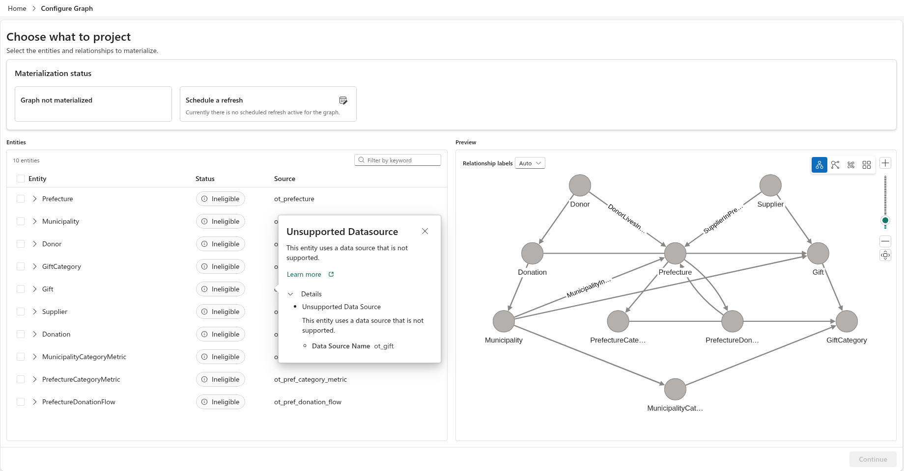

# 16.2 操作手順（2）

[Lab 目次](../README.md) · [この章の目次](README.md)

Configure Graph の判定画面。この例では10 Entity が Ineligible、Gift の理由が Unsupported Datasource（ot_gift）で、Continue は無効です。右側は Preview であり、Graph not materialized と表示されています。理由を確認し、未対応の間は新規の実体化を止めます。この画面のように未実体化なら、GQL の確認も未実施として記録します。静的テーブルの検証とは分けて扱います。

English

## 16.2 Steps

Configure Graph eligibility screen. All ten entities are Ineligible in this example; Gift reports Unsupported Datasource for ot_gift, and Continue is disabled. The right panel is a Preview, while the status says Graph not materialized. Inspect the reason and stop new materialization while unsupported. In an unmaterialized state like this one, record GQL checks as unrun. Verify static tables separately.

