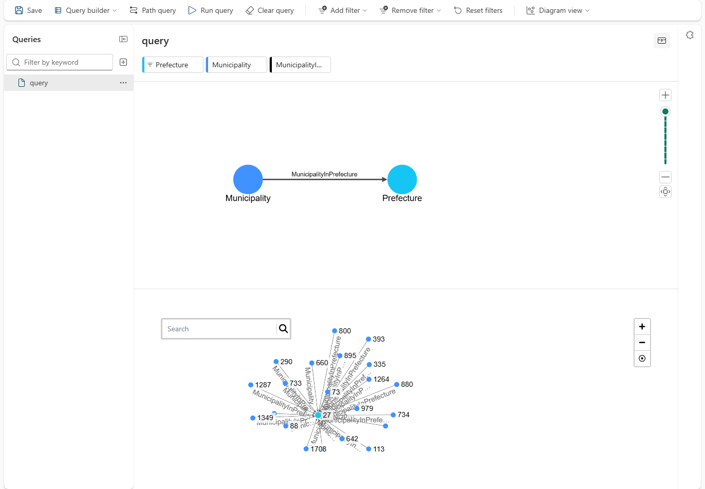

# 16.2 操作手順（3）

[Lab 目次](../README.md) · [この章の目次](README.md)

3. Projection Summary で Node と Edge の範囲を確認し、Materialize を選びます。完了するまで待ちます。失敗や処理中の状態を、成功として扱いません。
4. Explore graph を開き、Components でチェックボックスを選んで対象を選びます（行をクリックしただけではフォーカスされるだけで、選択されないことがあります）。Add filter で条件（例：Gift の GiftId。全体を実体化した場合は PrefectureId = 42 なども使えます）を追加し、Run query を選びます。

全体を実体化した Graph で、Prefecture にフィルターを付けて Run query した結果。矢印は自治体 → 都道府県。ノードの数字は ID とは限らないため、Table view で確かめる

English

## 16.2 Steps

3. Check the node and edge scope in Projection Summary and select Materialize. Wait until it completes. Do not treat a failed or pending state as success.
4. Open Explore graph and select items with their checkboxes under Components (clicking a row only focuses it and may not select it). Add a condition with Add filter (for example a GiftId on Gift; PrefectureId = 42 also works if you materialized the whole model) and select Run query.

Run query with a filter on Prefecture in a graph of the whole model: arrows go from municipality to prefecture. Numbers on nodes may not be IDs, so check them in Table view.

