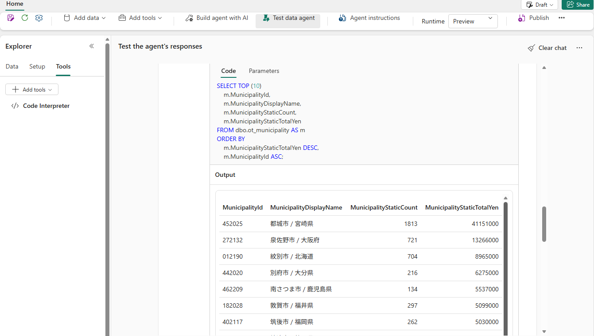

# 17.2 操作手順（1）

[Lab 目次](../README.md) · [この章の目次](README.md)

1. Add data または Sources で、Lakehouse、Eventhouse の KQL Database、主 Ontology を確認します。現在の UI では Ontology が別の区画に表示される場合があります。17.6で6つの agent_* ビューを用意し、17.7の6つの参照テーブルと5つの品質管理テーブルを合わせて、17オブジェクト・143列を実際の schema と照合します。手順と SQL 全文は本章に収録しています。
2. KQL Database では DonationObservationSummaryForAgent を選びます。このビューは「自治体 × 1分 × ファイル」単位で、EventID を持ちません。Notebook05 の品質処理（重複・受入・隔離や DQ）を明示して質問する場合にのみ、Lakehouse の bronze.donation_events_raw、silver.donation_event、quarantine.donation_events_rejected と、ops の品質管理テーブルを使います。EventID は上記の bronze・silver・quarantine の表で確認できますが、通常の Eventhouse 観測への質問を、この別の母集団で代用しません。
3. 同じ Agent に、Semantic model（SM_Furusato_Analytics_&lt;PID&gt;）をソースとして直接追加し、寄附・寄附者・日付・自治体・返礼品の5つのテーブルを選びます。Ontology 経由では Semantic model の DAX を使えないためです。3つの通常ソースと、別の区画にある主 Ontology を合わせて確認します。Ontology の登録だけでは利用可能とは限らないため、選択と利用できる文脈も確認します。警告や SchemaUnavailable がある場合は、下の確認表の2行目に従います。
4. Agent instructions と SQL・KQL・Semantic model の3つのソース指示には、17.8〜17.13に全文を収録した measured-contract-20261015 を使います。17.16で現在の schema・メジャー・選択を照合して設定し、公開版を読み戻します。Gen2 Ontology は専用の指示欄を持たないため、その選択と Entity の説明を保持します。古い Ontology 指示を global に足したり、Notebook 04 の初期定義を移行済み Agent に再適用したりしません。ID は自分の配置から取得し、他の配置からコピーしません。
5. Explorer の Tools で、17.5で追加した Code Interpreter が同じ Agent にあることを確認します。未設定なら17.5へ戻って追加し、17.16を新しい記録フォルダーで実施して公開・確認します。別の Agent は作りません。
6. Test data agent で Clear chat を選び、確認画面で確定してから、次の質問を送ります。

```text
静的データを UTC の2025年（2025-01-01T00:00:00Z 以上、2026-01-01T00:00:00Z 未満）で絞り、寄付金額の合計が多い自治体の上位10件を、MunicipalityId、自治体の表示名、寄付件数、寄付金額で表にしてください。使ったソースと実行したクエリも示してください。
```

7. 回答の下の「… step completed」を展開し、実行された SQL（Code）と結果（Output）を確認します。1位が 452025 都城市（1,813件・41,151,000円）であることを確認します。



回答のステップを展開した Code タブ。実行された SQL と、Output に返された値（先頭は 452025 都城市、1,813件・41,151,000円）を確認する

<details>
<summary>English</summary>

## 17.2 Steps

1. Under Add data or Sources, check the Lakehouse, the Eventhouse KQL database and the main ontology. The current UI may show the ontology in a separate section. Prepare the six agent_* views in 17.6 and combine them with the six reference tables and five quality tables in 17.7, reconciling the selected 17 objects and 143 columns with the actual schema. This chapter includes the procedure and complete SQL.
2. Select DonationObservationSummaryForAgent in the KQL database. This view has municipality × minute × file grain and no EventID. Use the Lakehouse bronze.donation_events_raw, silver.donation_event and quarantine.donation_events_rejected tables and ops quality tables only when the question explicitly requests Notebook05 quality processing such as duplicates, acceptance, quarantine or DQ. EventID is available in the bronze, silver and quarantine tables, but do not substitute this different population for an ordinary question about Eventhouse observations.
3. Add the semantic model (SM_Furusato_Analytics_&lt;PID&gt;) directly to the same agent as a source and select its five tables: 寄附, 寄附者, 日付, 自治体 and 返礼品. This is needed because the semantic model's DAX is not available through the ontology. Check the three ordinary sources together with the main ontology in its separate section. Registration alone does not establish availability; check selection and usable context as well. For warnings or SchemaUnavailable, follow the second row of the check table below.
4. Use the measured-contract-20261015 global and three SQL, KQL and semantic-model instructions included in full in 17.8–17.13. In 17.16, check the current schema, measures and selections, apply the configuration and read the published version back. Gen2 ontology has no dedicated instruction field, so preserve its selections and authored entity descriptions. Never add legacy ontology instructions to global text or reapply the Notebook 04 initial definition over a migrated agent. Obtain IDs from your own deployment; do not copy another deployment’s IDs.
5. Under Tools in Explorer, confirm that Code Interpreter added in 17.5 is on this same agent. If missing, return to 17.5 to add it, then use a new record folder for 17.16 to publish and verify. Do not create another agent.
6. In Test data agent, select Clear chat, confirm it in the confirmation dialog, then send the following question.

```text
Using static donations in UTC calendar 2025 (at or after 2025-01-01T00:00:00Z and before 2026-01-01T00:00:00Z), list the top 10 municipalities by total donation amount with MunicipalityId, municipality display name, donation count and donation amount. Also show the source you used and the query you ran.
```

7. Expand "… step completed" under the answer and check the executed SQL (Code) and its result (Output). Confirm that the top entry is 452025 Miyakonojo (1,813 donations and JPY 41,151,000).


Code tab of the expanded answer step: check the SQL that ran and the values returned in Output (first row 452025 Miyakonojo, 1,813 donations / JPY 41,151,000).

</details>
