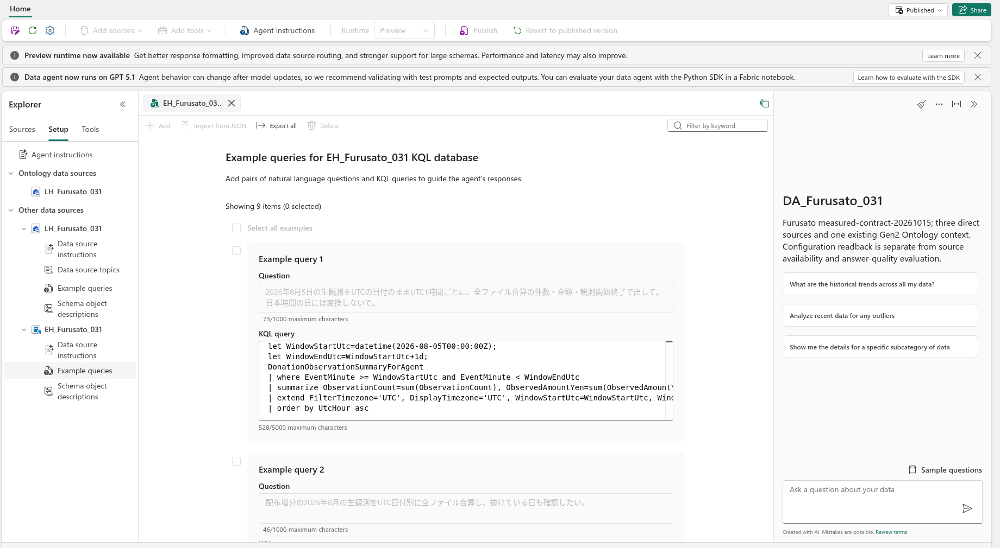

# 17.12 9件の KQL クエリ例を設定・検証する

[Lab 目次](../README.md) · [この章の目次](README.md)

まず8章の KQL Queryset で、自分の KQL Database を接続先に選び、下の9件の KQL を1件ずつ読み取り専用で実行します。各クエリの実行日時、成功またはエラー、返された結果を記録します。これは自分による実行の確認で、Data Agent が実行した証拠ではありません。すべて成功してから17.16で設定を適用・公開します。KQL ソースの Example queries / Examples でも9件のサービス検証を確認します。手作業で設定する場合は既存の例を記録してから、下の質問と KQL の組を9件設定します。質問欄には質問だけ、クエリ欄には対応する KQL だけを貼ります。評価問題や期待値を例に追加しません。各例を保存して検証結果を確認します。Valid にならない例は Agent に使われないため、9件の登録数だけで完了にしません。

17.16で公開した後は、画面右上で Published を選び、Setup → 自分の KQL Database → Example queries を開きます。Showing 9 items と、下記の9組の質問・KQL が保存されていることを確認します。登録数だけを Valid の証拠にせず、各例のサービス検証、先に行った直接実行の記録、19章の Agent の実回答を別々に照合します。画面内で横に隠れた KQL は横スクロールで確認し、コピーには下記の原文または同梱の kusto-examples.json を使います。



Published の Data Agent で、Setup から KQL Database の Example queries を選んだ画面です。Showing 9 items と最初の UTC 用の質問・KQL が表示されています。これは公開版の登録内容の確認です。9件すべての Valid、クエリの直接実行、Agent の回答とその精度は、それぞれ別に確認します。長い KQL の全文は下記の原文を使います。

KQL 例 1：質問欄

**question**

```text
2026年8月5日の生観測をUTCの日付のままUTC1時間ごとに、全ファイル合算の件数・金額・観測開始終了で出して。日本時間の日には変換しないで。
```

KQL 例 1：クエリ欄

**KQL**

```kql
let WindowStartUtc=datetime(2026-08-05T00:00:00Z);
let WindowEndUtc=WindowStartUtc+1d;
DonationObservationSummaryForAgent
| where EventMinute >= WindowStartUtc and EventMinute < WindowEndUtc
| summarize ObservationCount=sum(ObservationCount), ObservedAmountYen=sum(ObservedAmountYen), FirstObservedAtUtc=min(FirstObservedAt), LastObservedAtUtc=max(LastObservedAt) by UtcHour=bin(EventMinute,1h)
| extend FilterTimezone='UTC', DisplayTimezone='UTC', WindowStartUtc=WindowStartUtc, WindowEndUtc=WindowEndUtc
| order by UtcHour asc
```

KQL 例 2：質問欄

**question**

```text
配布増分の2026年8月の生観測をUTC日付別に全ファイル合算し、抜けている日も確認したい。
```

KQL 例 2：クエリ欄

**KQL**

```kql
let Daily = DonationObservationSummaryForAgent
| where EventMinute >= datetime(2026-08-01T00:00:00Z) and EventMinute < datetime(2026-09-01T00:00:00Z)
| summarize ObservationCount=sum(ObservationCount), ObservedAmountYen=sum(ObservedAmountYen), FirstObservedAtUtc=min(FirstObservedAt), LastObservedAtUtc=max(LastObservedAt) by UtcDay=bin(EventMinute,1d);
range UtcDay from datetime(2026-08-01) to datetime(2026-08-31) step 1d
| join kind=leftouter Daily on UtcDay
| project UtcDay, HasObservation=isnotnull(ObservationCount), ObservationCount=coalesce(ObservationCount,0), ObservedAmountYen=coalesce(ObservedAmountYen,0), FirstObservedAtUtc, LastObservedAtUtc
| order by UtcDay asc
```

KQL 例 3：質問欄

**question**

```text
日本時間2026年8月20日の生観測について、重複込み件数・金額と対応する実観測UTC開始終了を見たい。
```

KQL 例 3：クエリ欄

**KQL**

```kql
DonationObservationSummaryForAgent
| where EventMinute >= datetime(2026-08-19T15:00:00Z) and EventMinute < datetime(2026-08-20T15:00:00Z)
| summarize ObservationCount=sum(ObservationCount), ObservedAmountYen=sum(ObservedAmountYen), FirstObservedAtUtc=min(FirstObservedAt), LastObservedAtUtc=max(LastObservedAt)
| extend RequestedJstDate='2026-08-20', Timezone='UTC'
```

KQL 例 4：質問欄

**question**

```text
2026年8月のCSVごとに記録上の最終配信日時とイベント時刻、件数、金額を比べたい。実際の取込完了時刻とは区別して。
```

KQL 例 4：クエリ欄

**KQL**

```kql
DonationObservationSummaryForAgent | where EventMinute >= datetime(2026-08-01T00:00:00Z) and EventMinute < datetime(2026-09-01T00:00:00Z) | summarize ObservationCount=sum(ObservationCount), ObservedAmountYen=sum(ObservedAmountYen), FirstObservedAtUtc=min(FirstObservedAt), LastObservedAtUtc=max(LastObservedAt), SyntheticCsvPublishedAtUtc=max(LastPublishedAtUtc) by SourceFile, WorkshopRunId, ParticipantAlias | extend PublicationSemantics='Synthetic CSV PublishedAtUtc metadata; not actual Eventhouse publication, ingestion or pipeline completion', Timezone='UTC' | order by SourceFile asc
```

KQL 例 5：質問欄

**question**

```text
2026年8月の観測データで、集約ビューの行数と元の観測件数と金額を比較したい。1行の粒度も説明して。
```

KQL 例 5：クエリ欄

**KQL**

```kql
DonationObservationSummaryForAgent
| where EventMinute >= datetime(2026-08-01T00:00:00Z) and EventMinute < datetime(2026-09-01T00:00:00Z)
| summarize BucketRows=count(), ObservationCount=sum(ObservationCount), ObservedAmountYen=sum(ObservedAmountYen), FirstObservedAtUtc=min(FirstObservedAt), LastObservedAtUtc=max(LastObservedAt)
| extend RowGrain='MunicipalityID, EventMinute, WorkshopRunId, ParticipantAlias, SourceFile', Timezone='UTC'
```

KQL 例 6：質問欄

**question**

```text
日本時間の2026年8月5日の生観測を対象に、時間帯と観測開始終了だけはUTC表示にして、1時間ごとの件数と金額を全ファイル合算して。
```

KQL 例 6：クエリ欄

**KQL**

```kql
let WindowStartUtc=datetime_local_to_utc(datetime(2026-08-05T00:00:00),'Asia/Tokyo');
let WindowEndUtc=datetime_local_to_utc(datetime(2026-08-06T00:00:00),'Asia/Tokyo');
DonationObservationSummaryForAgent
| where EventMinute >= WindowStartUtc and EventMinute < WindowEndUtc
| summarize ObservationCount=sum(ObservationCount), ObservedAmountYen=sum(ObservedAmountYen), FirstObservedAtUtc=min(FirstObservedAt), LastObservedAtUtc=max(LastObservedAt) by UtcHour=bin(EventMinute,1h)
| extend FilterTimezone='Asia/Tokyo', DisplayTimezone='UTC', WindowStartUtc=WindowStartUtc, WindowEndUtc=WindowEndUtc
| order by UtcHour asc
```

KQL 例 7：質問欄

**question**

```text
年の指定がない「8月」の生観測全体について、重複込みの件数・金額と実際の観測開始・終了を知りたい。
```

KQL 例 7：クエリ欄

**KQL**

```kql
let WindowStartUtc=datetime(2026-08-01T00:00:00Z); let WindowEndUtc=datetime(2026-09-01T00:00:00Z); DonationObservationSummaryForAgent | where EventMinute >= WindowStartUtc and EventMinute < WindowEndUtc | summarize ObservationCount=sum(ObservationCount), ObservedAmountYen=sum(ObservedAmountYen), FirstObservedAtUtc=min(FirstObservedAt), LastObservedAtUtc=max(LastObservedAt), Files=dcount(SourceFile) | extend WindowStartUtc=WindowStartUtc, WindowEndUtc=WindowEndUtc, OperationalYear='2026', DuplicateCaveat='raw observations; EventID is not available', Timezone='UTC'
```

KQL 例 8：質問欄

**question**

```text
8月の生観測で、件数と金額それぞれの上位3自治体を両方の値つきで見たい。
```

KQL 例 8：クエリ欄

**KQL**

```kql
let Base = DonationObservationSummaryForAgent | where EventMinute >= datetime(2026-08-01T00:00:00Z) and EventMinute < datetime(2026-09-01T00:00:00Z) | summarize ObservationCount=sum(ObservationCount), ObservedAmountYen=sum(ObservedAmountYen) by MunicipalityID; let ByCount = Base | order by ObservationCount desc, MunicipalityID asc | take 3 | extend LeaderMetric='ObservationCount'; let ByAmount = Base | order by ObservedAmountYen desc, MunicipalityID asc | take 3 | extend LeaderMetric='ObservedAmountYen'; union ByCount, ByAmount | extend DuplicateCaveat='raw observations may include duplicates', Timezone='UTC' | order by LeaderMetric asc, ObservationCount desc
```

KQL 例 9：質問欄

**question**

```text
生観測の照会が0件だった。このビューに実際にある観測期間と総数を確認したい。
```

KQL 例 9：クエリ欄

**KQL**

```kql
DonationObservationSummaryForAgent | summarize ObservationCount=sum(ObservationCount), ObservedAmountYen=sum(ObservedAmountYen), FirstObservedAtUtc=min(FirstObservedAt), LastObservedAtUtc=max(LastObservedAt), Files=dcount(SourceFile) | extend Scope='whole view extent', Timezone='UTC'
```

<details>
<summary>English</summary>

## 17.12 Set and validate nine KQL examples

First connect the Chapter 8 KQL queryset to your KQL database and run each of the nine KQL queries below as a separate read-only query. Record its execution time, success or error and returned results. This proves your direct execution, not Data Agent execution. Apply and publish through 17.16 only after all nine succeed. Also check all nine service validations under the KQL source Example queries / Examples. For manual configuration, record existing examples before configuring the nine question-and-KQL pairs below. Paste only the question into the question field and only its paired KQL into the query field. Do not add evaluation questions or expected answers as examples. Save each and check validation. Non-Valid examples are not used by the agent, so a count of nine alone does not establish completion.

After publishing through 17.16, select Published at the top right and open Setup → your KQL Database → Example queries. Check Showing 9 items and the saved nine question/KQL pairs below. Do not treat the registered count as proof of Valid status: compare each service validation, your earlier direct-execution record and the actual Agent answers in Chapter 19 separately. Horizontally scroll any clipped KQL; copy from the complete source below or the included kusto-examples.json.


Published Data Agent with Setup → KQL Database → Example queries selected. The screen shows Showing 9 items and the first UTC question/KQL pair. This verifies registered content in the published version. Check all nine Valid statuses, direct query execution, and Agent answers and accuracy separately. Use the complete KQL source below for long queries.

KQL example 1: question field

**question**

```text
2026年8月5日の生観測をUTCの日付のままUTC1時間ごとに、全ファイル合算の件数・金額・観測開始終了で出して。日本時間の日には変換しないで。
```

KQL example 1: query field

**KQL**

```kql
let WindowStartUtc=datetime(2026-08-05T00:00:00Z);
let WindowEndUtc=WindowStartUtc+1d;
DonationObservationSummaryForAgent
| where EventMinute >= WindowStartUtc and EventMinute < WindowEndUtc
| summarize ObservationCount=sum(ObservationCount), ObservedAmountYen=sum(ObservedAmountYen), FirstObservedAtUtc=min(FirstObservedAt), LastObservedAtUtc=max(LastObservedAt) by UtcHour=bin(EventMinute,1h)
| extend FilterTimezone='UTC', DisplayTimezone='UTC', WindowStartUtc=WindowStartUtc, WindowEndUtc=WindowEndUtc
| order by UtcHour asc
```

KQL example 2: question field

**question**

```text
配布増分の2026年8月の生観測をUTC日付別に全ファイル合算し、抜けている日も確認したい。
```

KQL example 2: query field

**KQL**

```kql
let Daily = DonationObservationSummaryForAgent
| where EventMinute >= datetime(2026-08-01T00:00:00Z) and EventMinute < datetime(2026-09-01T00:00:00Z)
| summarize ObservationCount=sum(ObservationCount), ObservedAmountYen=sum(ObservedAmountYen), FirstObservedAtUtc=min(FirstObservedAt), LastObservedAtUtc=max(LastObservedAt) by UtcDay=bin(EventMinute,1d);
range UtcDay from datetime(2026-08-01) to datetime(2026-08-31) step 1d
| join kind=leftouter Daily on UtcDay
| project UtcDay, HasObservation=isnotnull(ObservationCount), ObservationCount=coalesce(ObservationCount,0), ObservedAmountYen=coalesce(ObservedAmountYen,0), FirstObservedAtUtc, LastObservedAtUtc
| order by UtcDay asc
```

KQL example 3: question field

**question**

```text
日本時間2026年8月20日の生観測について、重複込み件数・金額と対応する実観測UTC開始終了を見たい。
```

KQL example 3: query field

**KQL**

```kql
DonationObservationSummaryForAgent
| where EventMinute >= datetime(2026-08-19T15:00:00Z) and EventMinute < datetime(2026-08-20T15:00:00Z)
| summarize ObservationCount=sum(ObservationCount), ObservedAmountYen=sum(ObservedAmountYen), FirstObservedAtUtc=min(FirstObservedAt), LastObservedAtUtc=max(LastObservedAt)
| extend RequestedJstDate='2026-08-20', Timezone='UTC'
```

KQL example 4: question field

**question**

```text
2026年8月のCSVごとに記録上の最終配信日時とイベント時刻、件数、金額を比べたい。実際の取込完了時刻とは区別して。
```

KQL example 4: query field

**KQL**

```kql
DonationObservationSummaryForAgent | where EventMinute >= datetime(2026-08-01T00:00:00Z) and EventMinute < datetime(2026-09-01T00:00:00Z) | summarize ObservationCount=sum(ObservationCount), ObservedAmountYen=sum(ObservedAmountYen), FirstObservedAtUtc=min(FirstObservedAt), LastObservedAtUtc=max(LastObservedAt), SyntheticCsvPublishedAtUtc=max(LastPublishedAtUtc) by SourceFile, WorkshopRunId, ParticipantAlias | extend PublicationSemantics='Synthetic CSV PublishedAtUtc metadata; not actual Eventhouse publication, ingestion or pipeline completion', Timezone='UTC' | order by SourceFile asc
```

KQL example 5: question field

**question**

```text
2026年8月の観測データで、集約ビューの行数と元の観測件数と金額を比較したい。1行の粒度も説明して。
```

KQL example 5: query field

**KQL**

```kql
DonationObservationSummaryForAgent
| where EventMinute >= datetime(2026-08-01T00:00:00Z) and EventMinute < datetime(2026-09-01T00:00:00Z)
| summarize BucketRows=count(), ObservationCount=sum(ObservationCount), ObservedAmountYen=sum(ObservedAmountYen), FirstObservedAtUtc=min(FirstObservedAt), LastObservedAtUtc=max(LastObservedAt)
| extend RowGrain='MunicipalityID, EventMinute, WorkshopRunId, ParticipantAlias, SourceFile', Timezone='UTC'
```

KQL example 6: question field

**question**

```text
日本時間の2026年8月5日の生観測を対象に、時間帯と観測開始終了だけはUTC表示にして、1時間ごとの件数と金額を全ファイル合算して。
```

KQL example 6: query field

**KQL**

```kql
let WindowStartUtc=datetime_local_to_utc(datetime(2026-08-05T00:00:00),'Asia/Tokyo');
let WindowEndUtc=datetime_local_to_utc(datetime(2026-08-06T00:00:00),'Asia/Tokyo');
DonationObservationSummaryForAgent
| where EventMinute >= WindowStartUtc and EventMinute < WindowEndUtc
| summarize ObservationCount=sum(ObservationCount), ObservedAmountYen=sum(ObservedAmountYen), FirstObservedAtUtc=min(FirstObservedAt), LastObservedAtUtc=max(LastObservedAt) by UtcHour=bin(EventMinute,1h)
| extend FilterTimezone='Asia/Tokyo', DisplayTimezone='UTC', WindowStartUtc=WindowStartUtc, WindowEndUtc=WindowEndUtc
| order by UtcHour asc
```

KQL example 7: question field

**question**

```text
年の指定がない「8月」の生観測全体について、重複込みの件数・金額と実際の観測開始・終了を知りたい。
```

KQL example 7: query field

**KQL**

```kql
let WindowStartUtc=datetime(2026-08-01T00:00:00Z); let WindowEndUtc=datetime(2026-09-01T00:00:00Z); DonationObservationSummaryForAgent | where EventMinute >= WindowStartUtc and EventMinute < WindowEndUtc | summarize ObservationCount=sum(ObservationCount), ObservedAmountYen=sum(ObservedAmountYen), FirstObservedAtUtc=min(FirstObservedAt), LastObservedAtUtc=max(LastObservedAt), Files=dcount(SourceFile) | extend WindowStartUtc=WindowStartUtc, WindowEndUtc=WindowEndUtc, OperationalYear='2026', DuplicateCaveat='raw observations; EventID is not available', Timezone='UTC'
```

KQL example 8: question field

**question**

```text
8月の生観測で、件数と金額それぞれの上位3自治体を両方の値つきで見たい。
```

KQL example 8: query field

**KQL**

```kql
let Base = DonationObservationSummaryForAgent | where EventMinute >= datetime(2026-08-01T00:00:00Z) and EventMinute < datetime(2026-09-01T00:00:00Z) | summarize ObservationCount=sum(ObservationCount), ObservedAmountYen=sum(ObservedAmountYen) by MunicipalityID; let ByCount = Base | order by ObservationCount desc, MunicipalityID asc | take 3 | extend LeaderMetric='ObservationCount'; let ByAmount = Base | order by ObservedAmountYen desc, MunicipalityID asc | take 3 | extend LeaderMetric='ObservedAmountYen'; union ByCount, ByAmount | extend DuplicateCaveat='raw observations may include duplicates', Timezone='UTC' | order by LeaderMetric asc, ObservationCount desc
```

KQL example 9: question field

**question**

```text
生観測の照会が0件だった。このビューに実際にある観測期間と総数を確認したい。
```

KQL example 9: query field

**KQL**

```kql
DonationObservationSummaryForAgent | summarize ObservationCount=sum(ObservationCount), ObservedAmountYen=sum(ObservedAmountYen), FirstObservedAtUtc=min(FirstObservedAt), LastObservedAtUtc=max(LastObservedAt), Files=dcount(SourceFile) | extend Scope='whole view extent', Timezone='UTC'
```

</details>
