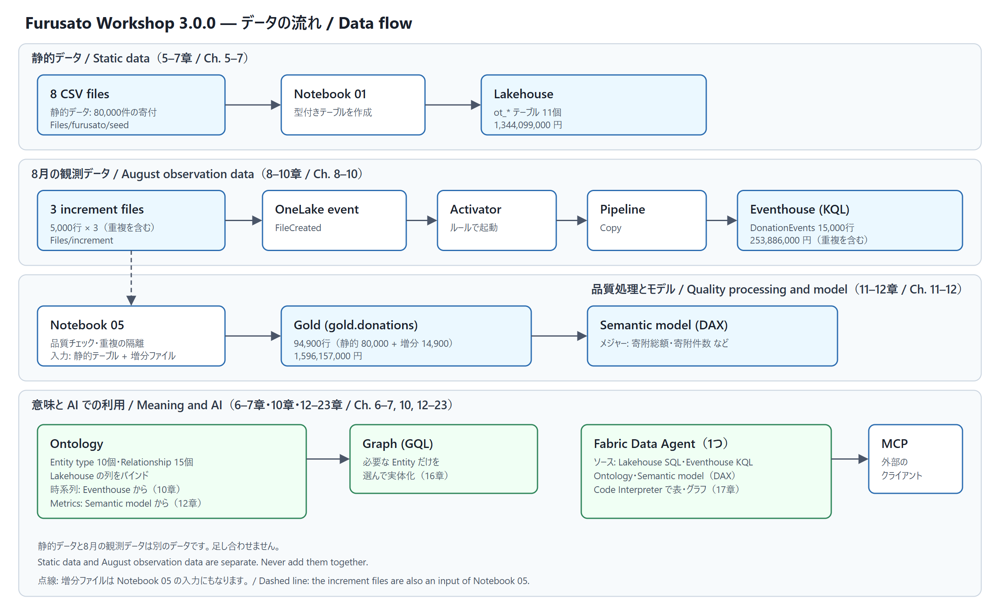

# Furusato Workshop 3.0.0

Microsoft Fabric の Lakehouse・Eventhouse・Ontology・Semantic model・Data Agent を組み合わせ、合成データから業務の意味を共有できる分析基盤を作るハンズオンです。

[**Labで始める**](Lab/README.md) · [**日英HTML手順書**](docs/furusato-workshop-v3-0-0-complete.html) · [**参加者用ZIP**](docs/Furusato_Workshop_v3.0.0_current.zip) · [ダウンロードとSHA-256](docs/README.md)

## 進め方

1. [第4章](Lab/04-prerequisites-deployment-scope-and-safe-execution/README.md)で、利用できるワークスペース・容量・権限・自分の作業フォルダーと参加者IDを確認します。
2. [第24章](Lab/24-automated-deployment-operations-and-cleanup/README.md)の24.4〜24.6で基盤を配置し、第5〜8章で作成済みの設定とデータを確認します。
3. 第24.7節と第9〜11章で3つの増分ファイルを順に取り込み、品質処理とGoldを確認します。成功した取り込みやNotebookを重複して実行しません。
4. 第24.8節でSemantic modelとData Agentを完成させ、[第17章](Lab/17-fabric-data-agent-and-code-interpreter/README.md)で指示・選択列・クエリ例・Code Interpreter・公開状態を確認します。
5. [第19章](Lab/19-evaluate-and-improve-ai-answer-quality/README.md)と[付録C](Lab/appendix-c-evaluation-questions-scoring-and-recording-forms/README.md)で回答を評価し、根拠となる問い合わせと結果を調べて改善します。

Labは24章・5付録の全手順を収録しています。キャプチャごとの操作ページに加え、準備、コマンド、設定の全文、参照表、完了条件、評価問題と採点基準を掲載しています。各ページの **English** を開くと英語の手順を読めます。HTMLはファイルとして保存し、ブラウザーで日英切替・検索・進捗チェック・印刷を利用できます。

## 作成するもの

1件のOntologyと1件のData Agentを中心に、Lakehouseの静的データ、Eventhouseの観測データ、品質処理後のGold、Semantic modelを接続します。Data AgentはLakehouse SQL・KQL Database・Semantic modelの3つの通常ソースと、同じOntologyへの独立したcontext登録を使用します。Code Interpreterも同じAgentのツールです。

利用にはFabricの有効な容量と必要な権限が必要です。機能の提供条件はテナント・リージョンによって異なります。設定画面の表示、実際の実行、公開後の動作はそれぞれ確認します。同じ設定の再現が、同じ回答精度を保証するわけではありません。

Ontologyのnative Metricsは講師による事前設定が必要です。未設定の場合は設定済みと扱わず、講師に確認します。[第4章](Lab/04-prerequisites-deployment-scope-and-safe-execution/README.md)の容量画面は実環境の例であり、表示されたF16は最小要件ではありません。増分取り込みの確認では、対象ファイル・イベント・Activator・Pipelineの実行を対応付けます。成功表示や行数だけで自動配信の完了とは判定しません。

初回の増分取り込みより前に、`deploy-realtime` が `DonationEvents` だけの OneLake mirroring を安全に有効化していることを確認します。policy の読み戻しは Delta データの到着や Ontology の native 時系列実行を証明しません。実際の Delta ファイルと取り込み結果を照合し、Lab の完了条件を満たしてから次へ進みます。

データはすべて学習用の合成データです。自治体名と自治体コードだけが実在の参照ラベルで、寄付・寄付者・事業者・返礼品は架空です。静的寄付と増分の観測は母集団と粒度が異なるため、混同して集計しません。

## 実行資産

| 場所 | 内容 |
|---|---|
| [Lab/](Lab/README.md) | 最新版の参加者用Markdown手順書と画面キャプチャ |
| [docs/](docs/README.md) | 保存して使える日英HTML、参加者用ZIP、SHA-256 |
| [workshop/v3.0.0-preview/](workshop/v3.0.0-preview/) | Notebook、CSV、Ontology、モデル、Agent設定、添付資料 |
| [tools/](tools/) | 配置、データ検証、回答評価、教材生成のツール |

参加者用ZIPはすべて展開し、同じ版の手順書と実行資産を使ってください。ローカルのコマンドはリポジトリのルート、ZIPでは展開先の `source/` を起点に実行します。資格情報、環境固有の接続情報、非公開の回答ログはGitHubへ追加しません。[SECURITY.md](SECURITY.md)も確認してください。

## English

Build and inspect a Microsoft Fabric solution with synthetic data, one Ontology and one Data Agent. Start with the complete [Lab guide](Lab/README.md), or save the [bilingual HTML](docs/furusato-workshop-v3-0-0-complete.html) for local use. Download the matching [participant ZIP](docs/Furusato_Workshop_v3.0.0_current.zip) and verify its [SHA-256](docs/SHA256SUMS.txt).

Follow Chapters 4 and 24 for scoped deployment, Chapters 5–13 for data and model checks, Chapter 17 for the complete adopted Agent configuration, and Chapter 19 plus Appendix C for evaluation and improvement. Each Lab operation has its own Markdown page; expand **English** for the equivalent procedure. All 24 chapters and five appendices include the preparation, commands, full settings, reference tables and completion checks.

Use an authorized workspace and folder with active capacity and the required feature permissions. Verify actual execution and published behavior separately from configuration. Matching a configuration does not guarantee an identical answer score. All data is synthetic training material, and static donations must remain distinct from operational observations.

Native Ontology Metrics require instructor setup; an unconfigured feature is not a verified configuration. The Chapter 4 capacity screenshot is a real environment example, not an F16 minimum requirement. Correlate the exact increment file, event, Activator and Pipeline run before accepting automatic delivery; a success label or row count alone is insufficient.

Before the first increment, verify that `deploy-realtime` safely enables OneLake mirroring for `DonationEvents` only. Policy readback does not prove Delta data arrival or native Ontology time-series execution; reconcile actual Delta files and ingestion results against the Lab completion checks before proceeding.
