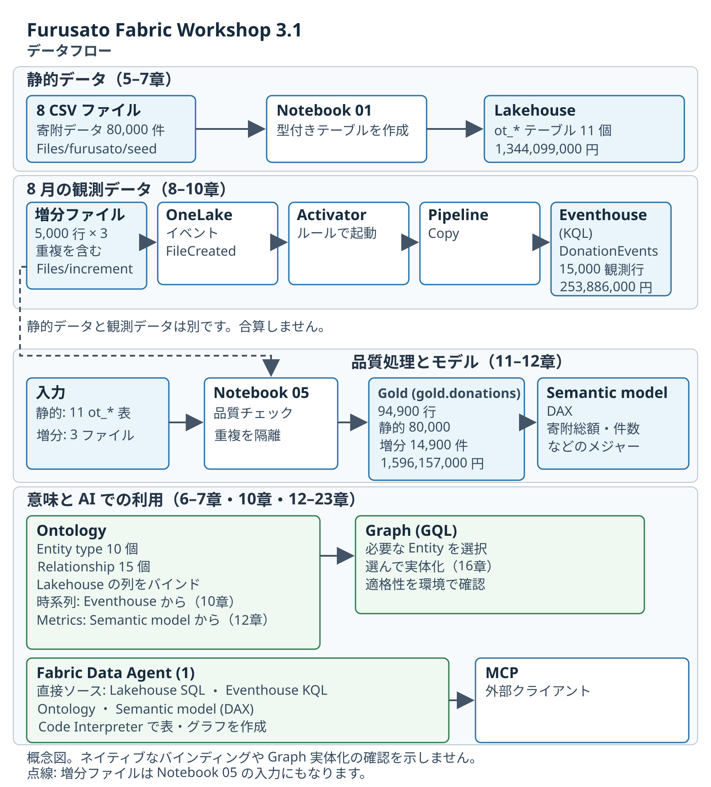
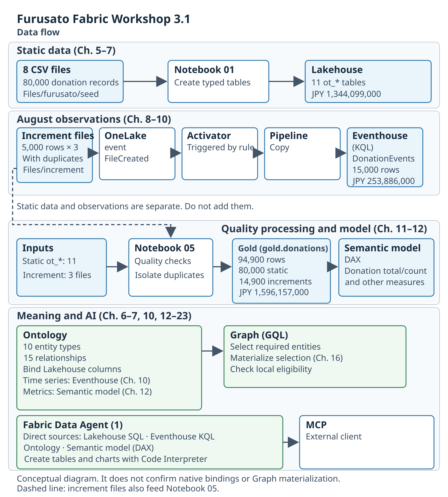

# Furusato Workshop 3.1.0

合成データを使い、Microsoft Fabric の Lakehouse・Eventhouse・Ontology・Semantic model・Data Agent をつなぐ日英ハンズオンです。

**[日英HTML手順書をダウンロード](docs/furusato-workshop-v3-1-0-complete.html?raw=true)**して、ブラウザーで開いてください。HTMLは必要なスタイル・動作・図を含む単一ファイルで、教材を読むだけならZIPやWebサイトは不要です。[GitHub Lab](Lab/README.md)は各手順の番号付きMarkdown版です。Notebook・データ・設定・コマンドなど、実習を実行する資産には同じ版の[参加者用ZIP](docs/Furusato_Workshop_v3.1.0_current.zip?raw=true)を使い、[SHA-256一覧](docs/SHA256SUMS.txt)で照合してください。[配布物と検証記録](docs/README.md)で現行ファイルを確認できます。リポジトリを使う場合はZIPの代わりにこのGitHub上の資産を利用できます。

## 進め方

1. [第4章](Lab/04-prerequisites-deployment-scope-and-safe-execution/README.md)で前提条件と安全なデプロイ範囲を確認します。
2. 第24章と第5〜13章に沿って対象リソースをデプロイまたは確認します。既存リソースを重複作成したり、処理済み入力を再処理したりしません。
3. [第17章](Lab/17-fabric-data-agent-and-code-interpreter/README.md)でモデルとData Agentを構成し、同じAgentのCode Interpreterを確認して、公開内容を読み戻します。
4. [第19章](Lab/19-evaluate-and-improve-ai-answer-quality/README.md)と[付録C](Lab/appendix-c-evaluation-questions-scoring-and-recording-forms/README.md)の固定質問・根拠要件で回答を評価します。

本教材は24章・5付録で構成されています。HTML教科書を参加者向けの主教材とし、番号付きの各手順へGitHub上から移動するにはLabを使います。どちらも日本語と英語に対応しています。

## 前提条件と根拠

利用が許可されたFabricワークスペースとフォルダー、稼働中の容量、必要な権限を用意します。機能の利用可否はテナント、リージョン、容量によって異なる場合があります。設定だけではクエリの実行、機能の準備完了、AI回答の正しさは確認できないため、実行結果と読み戻しを別々に確認してください。

データは合成データです。自治体名とコードは参照ラベルであり、寄付、寄付者、事業者、返礼品は架空です。静的レコード、運用観測、品質処理後のGoldデータは、母集団と粒度が異なるため区別してください。実際に公開したWorkshopを、記録したソース、クエリ、結果に基づいて評価します。本READMEは評価スコアや回答品質を保証しません。

参加者用ZIPにはHTML、Lab、実行資産、テキスト形式の参照添付ファイルが含まれます。WordまたはPDF形式の手順書・出力ファイルは含まれません。業務要件の添付ファイルはプレーンテキストです。上流アイコンの利用条件は[ソース通知](docs/assets/architecture/upstream/NOTICE.txt)に記載しています。

Git checkoutではリポジトリのルートからコマンドを実行します。ZIPを使う場合は展開し、`source/`ディレクトリから実行してください。資格情報、環境固有の接続情報、非公開の回答ログをGitHubへ追加しないでください。[SECURITY.md](SECURITY.md)も参照してください。

## English

This bilingual, hands-on Microsoft Fabric workshop uses synthetic data to connect a Lakehouse, Eventhouse, Ontology, semantic model and Data Agent.

Download the **[HTML textbook](docs/furusato-workshop-v3-1-0-complete.html?raw=true)** and open it in a browser. It is a single file containing its required styles, interactions and figures, so reading the manual does not require the ZIP or a hosted website. The [GitHub Lab](Lab/README.md) is the numbered Markdown companion. For hands-on execution, use the same-edition [participant ZIP](docs/Furusato_Workshop_v3.1.0_current.zip?raw=true) for notebooks, data, configuration and commands, and verify it with [SHA-256](docs/SHA256SUMS.txt). See the [download and validation index](docs/README.md) for the current files. If you work from the repository, its GitHub assets can be used instead of the ZIP.

Follow [Chapter 4](Lab/04-prerequisites-deployment-scope-and-safe-execution/README.md) for prerequisites and scope, Chapters 24 and 5–13 for deployment and data/model checks, [Chapter 17](Lab/17-fabric-data-agent-and-code-interpreter/README.md) to configure the Agent, confirm Code Interpreter on that same agent and read back the published setup, and [Chapter 19](Lab/19-evaluate-and-improve-ai-answer-quality/README.md) plus [Appendix C](Lab/appendix-c-evaluation-questions-scoring-and-recording-forms/README.md) for answer evaluation.

The course has 24 chapters and five appendices. Use the HTML as the primary participant manual and the Lab for direct GitHub navigation to each numbered step. The participant ZIP contains HTML, Lab, runtime assets and plain-text reference attachments; it contains no Word or PDF manuals or exports. The business requirements attachment is plain text, and the upstream icon usage terms are retained in the [source notice](docs/assets/architecture/upstream/NOTICE.txt).

Use an authorized Fabric workspace and folder with active capacity and the required permissions. Feature availability may vary by tenant, region and capacity. Configuration is not proof of execution, feature readiness or answer correctness. All workshop data is synthetic. Static donations, operational observations and quality-processed Gold have different populations and grains and must remain distinct. Verify actual sources, queries and results; no evaluation score or answer-quality guarantee is made.

Run commands from the repository root in a Git checkout, or from the extracted ZIP’s `source/` directory. Never add credentials, environment-specific connection details or private answer logs to GitHub. Review [SECURITY.md](SECURITY.md).
