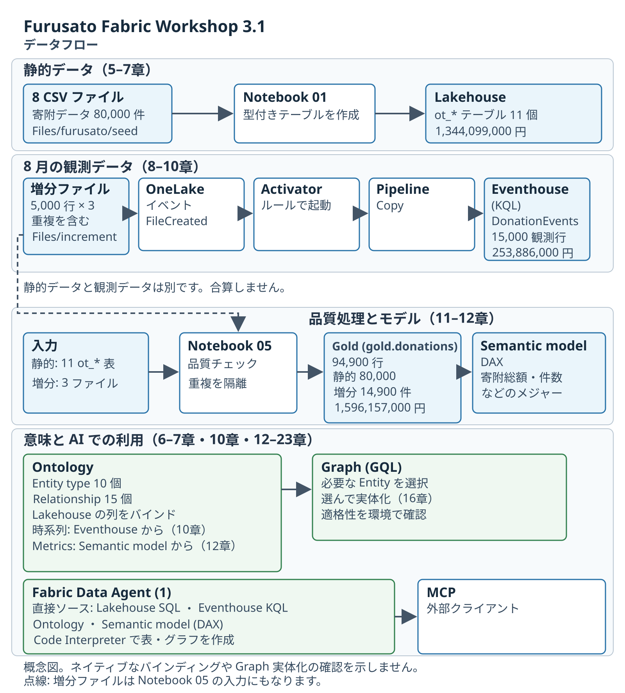
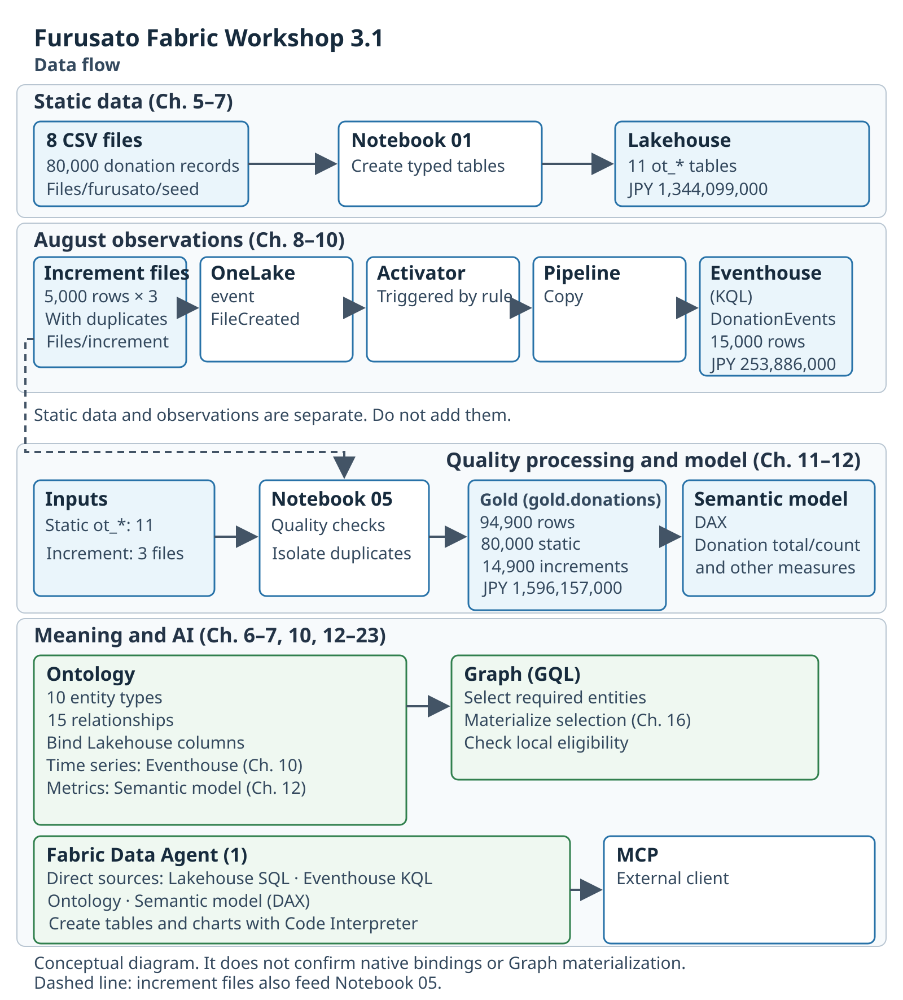

# Furusato Fabric Workshop — Architecture

[日本語](overview.ja.md) · [English](overview.en.md) · [Interactive explorer](index.html)

**The architecture of the current participant edition, Workshop 3.1.0.**
Repository runtime inputs may retain directory names such as `workshop/v2.7.0/`;
those are actual file paths, not the participant-edition number.
All donation, donor and supplier records are synthetic teaching data.

| 日本語 | English |
|---|---|
|  |  |
| [解説](overview.ja.md) · [SVG](../../Lab/assets/pc-01-architecture-ja.svg) | [Explanation](overview.en.md) · [SVG](../../Lab/assets/pc-01-architecture-en.svg) |

## Explore locally / ローカルで見る

Open **[`index.html`](index.html)** in a browser after downloading/cloning the repository.
GitHub's file view shows the HTML source; the local page is the interactive experience.
The page works from `file://`, with local assets, without a build step, external framework,
font download, remote analytics, sign-in or Fabric connection.

- Japanese: `index.html?lang=ja&focus=overview`
- English: `index.html?lang=en&focus=overview`
- Flow focus: `static`, `events`, `agent`, `analytics`, `control`, `outcomes`
- Click a flow button or diagram card. Use **Tab**, **Enter** or **Space**.
- Shortcuts: **0** overview, **1–4** numbered flows, **5** setup, **6** learning outcomes,
  **J / E** language, **Escape** overview. Shortcuts pause inside controls.
- At **2560 × 1440**, use browser zoom **100%** for the full diagram and readable detail panel.
  The diagram scrolls horizontally on small screens; controls and explanation reflow.
- Use **Expand diagram** for a full-width reading view. The participant Lab SVGs linked above
  are the canonical bilingual architecture diagrams.

## An ending for the architecture walkthrough / 動画の最後に使う

This is a browser-based explorer, not a slide deck. A suggested closing route:

1. **Overview** — begin with the business question.
2. **01 Static & meaning** — follow donation facts into business relationships.
3. **02 Observations** — distinguish the operational observation population.
4. **03 One Agent** — connect the four logical sources to their actual query evidence.
5. **04 Quality & BI** — follow the separate, quality-gated analytics branch.
6. **00 Setup** — identify the preview / consent boundary briefly.
7. **Learning outcomes** — finish on the positive value statement.

The [bilingual closing narration and browser cues](walkthrough.md) follow this route.
They are intended for the **ending** of each revised promo video.
Recording, video assembly and publication remain separate steps.

The language toggle updates diagram text, controls, details, accessible names and download links.
The explorer makes no service calls and displays no live status. The diagram describes
the intended lifecycle: **formal start → verify actual delivery → formal stop**.

## Evidence and icon rights / 根拠とアイコン利用条件

- [Source anchors and interpretation](sources.md)
- [Icon provenance and usage terms](icons.md)
- [Machine-readable icon manifest](../assets/architecture/icon-manifest.json)
- [Existing single-Agent guide](../single-agent-workshop.md)

The icon source is the **user-specified
[`yang-jiayi/AzureDiagarm` collection](https://github.com/yang-jiayi/AzureDiagarm/tree/main/Azure_Public_Service_Icons/Icons)**.
Microsoft icons retain their original artwork and applicable Microsoft terms.
The workshop's MIT license does not relicense Microsoft marks.

The diagrams use logical names and `{PID}` placeholders. They explain the repository design;
they do not report live Fabric status or expose environment identifiers.
