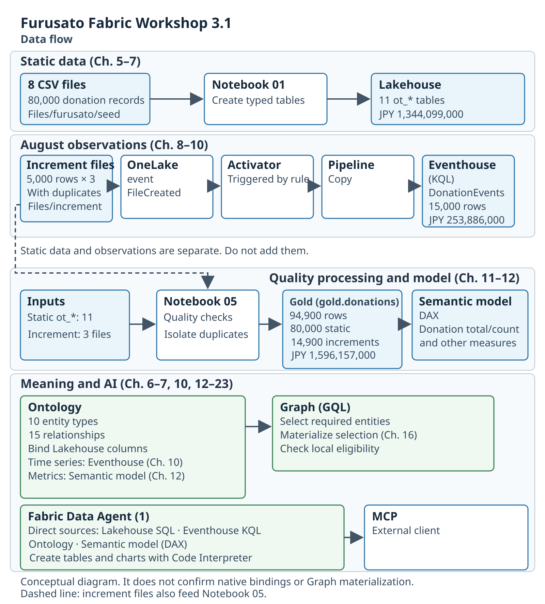

# Furusato Workshop 3.1.0 architecture

[日本語](overview.ja.md) · [Interactive architecture](index.html?lang=en&focus=overview) ·
[Implementation evidence](sources.md)

Workshop 3.1.0 is the participant edition for learning how a Lakehouse, Eventhouse,
Ontology, semantic model and Data Agent fit together using synthetic data.
Donors, suppliers, gifts and donation records are synthetic.

[Open the current architecture diagram](../../Lab/assets/pc-01-architecture-en.svg) ·
[Participant guide, Chapter 17](../furusato-workshop-v3-1-0-complete.html#ch-17) ·
[Chapter 17 GitHub Lab](../../Lab/17-fabric-data-agent-and-code-interpreter/README.md)

## Final Data Agent configuration

The primary Agent uses four logical sources. Each question uses the relevant source or sources; it does not require every source to run in a fixed order. Match actual queries to their results.

| Logical source | Role | Execution evidence |
|---|---|---|
| Lakehouse | Static data and modeled reference data | Executed SQL and returned values |
| KQL Database | Eventhouse operational observations | Executed KQL and returned values |
| Semantic model | Selected analytical model | Executed DAX and actual model columns/measures |
| Ontology | Business entities and relationship context | The actual GQL and result only when GQL was executed |

Code Interpreter is a tool in the same Agent, not a fifth source. Ontology grounding
or a configuration display alone does not prove that GQL ran. For each answer,
verify the actual source, query language, query and result.

Notebook 05, quality-checked Gold, Direct Lake and Power BI form the analytics path.
Keep that population distinct from Eventhouse raw observations and static donations.

## Participant procedures

- Use [Chapter 17](../../Lab/17-fabric-data-agent-and-code-interpreter/README.md) to inspect the existing Agent's four logical sources, Code Interpreter and published configuration.
- Evaluate actual answers with [Chapter 19](../../Lab/19-evaluate-and-improve-ai-answer-quality/README.md) and [Appendix C](../../Lab/appendix-c-evaluation-questions-scoring-and-recording-forms/README.md).
- Use [Chapter 24](../../Lab/24-automated-deployment-operations-and-cleanup/README.md) for deployment scope and client-specific procedures.
- Open the latest HTML, Lab and ZIP from the [README](../../README.md) and [download validation index](../README.md).

Names such as `workshop/v2.7.0/` and `workshop/v3.0.0-preview/` are actual
repository runtime paths, not the participant-edition number. This page and its
diagram explain repository design; they do not prove live status, deployment
completion or answer accuracy.
