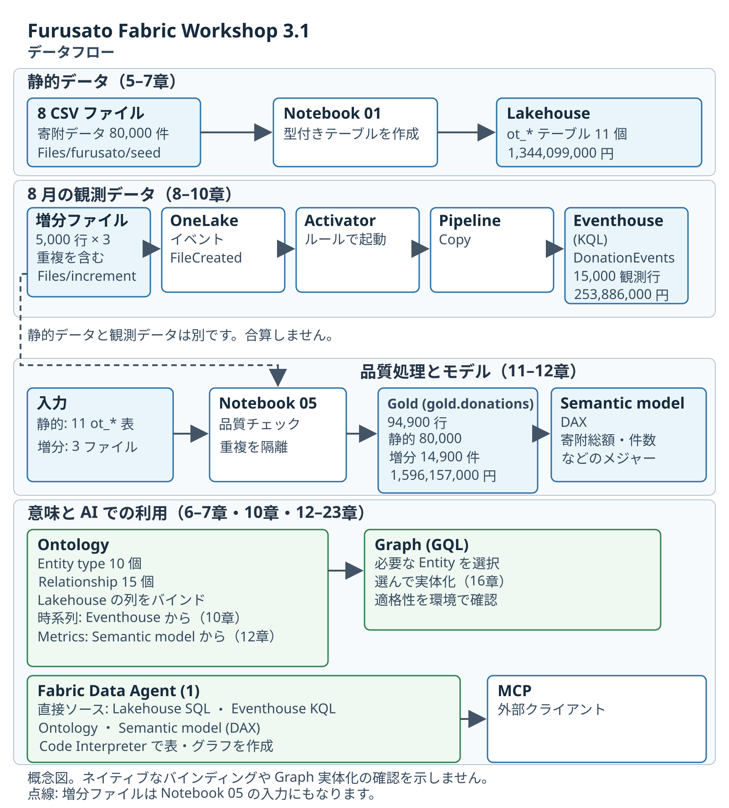

# Furusato Workshop 3.1.0 のアーキテクチャ

[English](overview.en.md) · [対話型アーキテクチャ](index.html?lang=ja&focus=overview) ·
[実装の根拠](sources.md)

Workshop 3.1.0 は、合成データを使って Lakehouse、Eventhouse、Ontology、
Semantic model、Data Agent の関係を学ぶ参加者向け教材です。
寄付者・事業者・返礼品・寄付実績は合成データです。

[拡大できる現行アーキテクチャ図](../../Lab/assets/pc-01-architecture-ja.svg) ·
[参加者ガイド第17章](../furusato-workshop-v3-1-0-complete.html#ch-17) ·
[第17章 GitHub Lab](../../Lab/17-fabric-data-agent-and-code-interpreter/README.md)

## Data Agent の最終構成

主 Agent は4つの論理ソースを使います。各質問で必要なソースを選び、実際に実行した照会と結果を対応させます。すべての質問で4ソースを順番に実行するという意味ではありません。

| 論理ソース | 役割 | 実行証拠 |
|---|---|---|
| Lakehouse | 静的データとモデル化された参照データ | 実行された SQL と返却値 |
| KQL Database | Eventhouse の運用観測 | 実行された KQL と返却値 |
| Semantic model | 選択された分析モデル | 実行された DAX とモデル上の列・メジャー |
| Ontology | 業務エンティティと関係の文脈 | 実際に GQL が実行された場合に限り、その GQL と返却値 |

Code Interpreter は同じ Agent のツールであり、5つ目のソースではありません。
Ontology による grounding や設定表示だけでは、GQL が実行された証拠になりません。
回答ごとに実際のソース、query language、query、result を確認します。

Notebook 05、品質確認済み Gold、Direct Lake、Power BI は分析経路です。
分析用の集団と Eventhouse の raw 観測、静的寄付を同じ母集団として扱いません。

## 参加者向け手順

- [第17章](../../Lab/17-fabric-data-agent-and-code-interpreter/README.md)で既存 Agent の4論理ソース、Code Interpreter、公開内容を確認します。
- [第19章](../../Lab/19-evaluate-and-improve-ai-answer-quality/README.md)と[付録C](../../Lab/appendix-c-evaluation-questions-scoring-and-recording-forms/README.md)で実回答を評価します。
- [第24章](../../Lab/24-automated-deployment-operations-and-cleanup/README.md)で、許可された範囲のデプロイとクライアント別手順を確認します。
- [README](../../README.md)と[配布物の検証](../README.md)から最新版の HTML、Lab、ZIP を開きます。

`workshop/v2.7.0/` と `workshop/v3.0.0-preview/` はリポジトリ内の実際のランタイムパスであり、参加者向け版番号ではありません。このページと図はリポジトリ設計の説明で、ライブ状態、配置完了、回答精度を証明しません。
